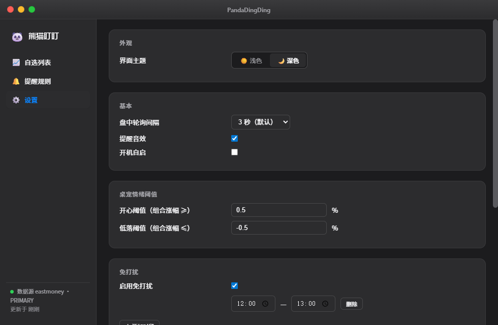
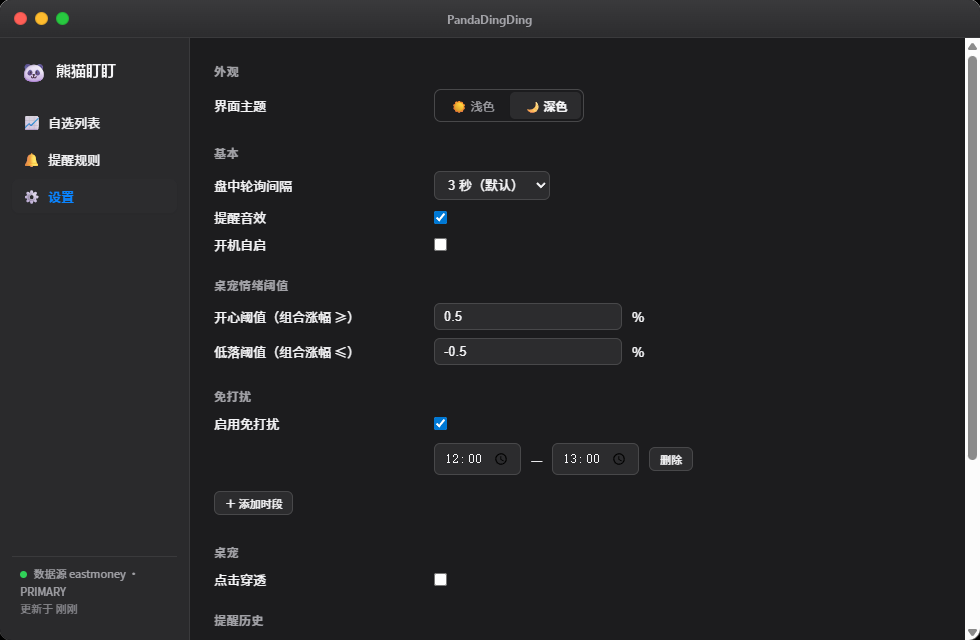
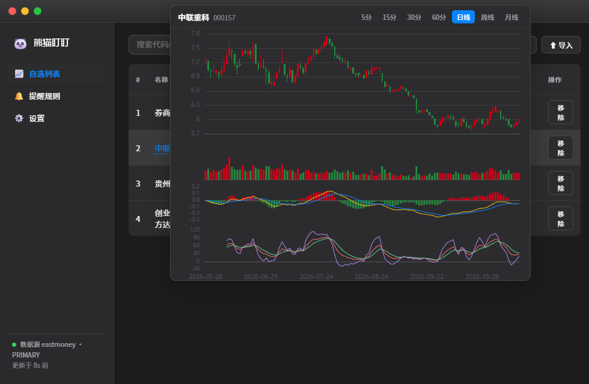
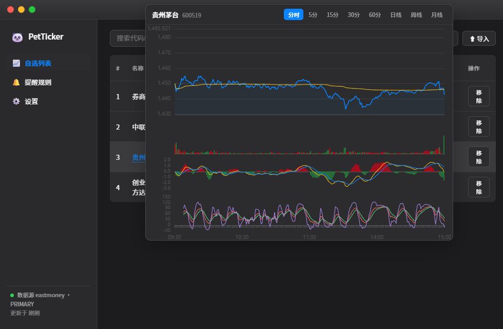

# PandaDingDing · 熊猫盯盯（桌宠股票基金监控）

一只常驻桌面的像素猫，实时盯着你的 A 股自选与场内基金：涨了开心、跌了蔫，越过阈值会主动跳出来喊你。

> **行情数据仅供参考，不构成投资建议。** 数据来自东方财富 / 腾讯财经公开接口，可能存在延迟。










---

## 功能

| 模块 | 状态 | 说明 |
| --- | --- | --- |
| 桌宠窗口 | ✅ | 透明 / 置顶 / 无边框 / 不占任务栏，2D 精灵逐帧动画（PixiJS）；设置或托盘可隐藏/显示，重启后保持选择 |
| 情绪状态机 | ✅ | 组合加权涨跌 → idle / idle-smile / idle-frown / happy / sad / panic-* / sleepy；happy 4 帧举「恭喜发财」横幅腾空跳（播完回站立）、sad 4 帧抹泪、sleepy 4 帧侧躺睡觉呼吸循环（收盘/周末/节假日、以及设置页免打扰时段自动切换） |
| 实时行情 | ✅ | 东方财富主源 + 腾讯备用源，自动容灾、降级、恢复回切 |
| 交易时段调度 | ✅ | 集合竞价 / 连续竞价 3s / 午休 30s / 盘后 60s / 周末节假日停轮询 |
| 阈值提醒 | ✅ | 标的级 / 全局级规则，气泡 + 桌宠 panic 动作，同向当日去重防骚扰 |
| 提醒规则 | ✅ | 涨跌幅 / 价格 / 成交量倍数（当日量 ÷ 近 5 日均量，盘中按时间折算）/ 连涨连跌天数 / 3 分钟涨速 / 触及涨跌停（ST 5%、创业板科创板 20%、北交所 30%、主板 10% 精确判定，差一分不算封板） |
| 免打扰 | ✅ | 可配置时段（默认午休 12:00–13:00），静默期内不弹气泡；桌宠在同一时段躺下睡觉（睡觉时气泡层整体淡出隐藏） |
| **上班三件套** | ✅ | **老板键**一键隐身（默认 `Ctrl/Cmd+Shift+H`，三个窗口同时收起，再按恢复）；**指数温度条**在桌面角落常驻上证/深成/创业板/科创50 四个指数（并入原有批量请求，零额外流量）；**定时时点提醒**默认 09:25 集合竞价 / 11:20 午盘前 / 14:45 过夜决策 / 14:55 尾盘，20 秒一轮扫描，误点不重复 |
| **持仓盈亏** | ✅ | 自选可填持仓股数与成本价：当日盈亏（按昨收）、累计盈亏（按成本价）、持仓市值、仓位权重；自选页顶部汇总组合当日盈亏。成本价留空视为「没填」而不是「白赚」 |
| **异动雷达** | ✅ | 本地价格环形缓冲计算 3 分钟急涨急跌（纯本地，不加请求）+ 触及涨跌停即时提醒，用来捕捉"突然拉起来/砸下去" |
| **盘后日报** | ✅ | 收盘自动生成并在设置页回看：红绿家数、组合涨跌幅、当日盈亏、沪深300 对比、领涨领跌、当日触发提醒次数 |
| **交易纪律** | ✅ | 防追高阈值（涨幅 ≥ N% 当日只提醒一次，默认 7%，0 关闭）+ 每日提醒上限（满额后自动静默，次日恢复）；纪律规则以「交易纪律」标签出现在提醒规则页，可自行改阈值或停用 |
| 管理面板 | ✅ | 自选表格（可排序、含持仓列）、规则编辑、定时提醒、设置、提醒历史、收盘报告 |
| 自选搜索 | ✅ | 代码/名称搜索（东财 suggest + 内置常用 ETF 兜底），支持 JSON 导入/导出自选 |
| 港股 / 美股 | ✅ | 按代码自动识别市场号，腾讯源覆盖港股、美股行情 |
| 场外基金 | ✅ | 净值型基金走 fund.eastmoney.com 净值通道（盘中显示最近净值 + 当日涨跌），与股票自选混排 |
| K 线浮层 | ✅ | 鼠标悬停自选名称弹出图表：**分时**/5/15/30/60 分、日/周/月线共 8 个 tabs，蜡烛图或分时走势 + 成交量 + MACD + KDJ 四面板 |
| 数据持久化 | ✅ | SQLite（自选 / 持仓 / 规则 / 定时提醒 / 提醒历史 / 收盘报告 / 设置 / 桌宠位置），带迁移脚本升级 |
| 托盘 | ✅ | 打开面板 / 切换点击穿透 / 免打扰 30 分钟 / 退出；图标带红涨绿跌角标，tooltip 快览组合涨跌、当日盈亏与数据源状态 |
| 拖拽移动 | ✅ | **按住熊猫主体即可拖动**（movementX/Y 相对位移，精准无跳变），也可拖窗口边缘；双击熊猫打开管理面板 |
| 自动漫游 | ✅ | 空闲 45 秒后沿屏幕底边散步（4 帧走路循环，撞边自动翻面），有提醒/离线/拖拽即中断；设置页可关闭 |
| 界面主题 | ✅ | macOS 风格浅色/深色双主题，设置页一键切换并持久化 |
| 气泡配色 | ✅ | 可自定义桌宠头顶行情气泡（股票名称）的背景色，修改后实时生效 |
| 气泡常显 | ✅ | 可选气泡常显模式：按自选列表顺序每 5 秒轮播一只，涨跌幅随行情实时刷新；关闭时恢复随机轻提示 |
| 气泡样式 | ✅ | 可自定义气泡背景色与文字大小（8–20px），修改后实时生效 |
| 皮肤切换 | ✅ | 设置页「桌宠皮肤」下拉可选全部已安装皮肤，切换即时生效（无需重启） |

路线图与未完成项见 [半成品功能待办.md](半成品功能待办.md)。

---

## 技术栈

- **Electron 38** + **Vue 3** + **TypeScript**（严格模式）
- **PixiJS 8** 逐帧精灵动画（手写 ticker 推进，便于诊断与控制）
- **better-sqlite3**（WAL，迁移脚本管理版本）
- **esbuild**（主进程 / preload 打包）+ **Vite**（渲染层）
- **zod** 校验所有 IPC 入参

## 架构速览

```
主进程 (Node)
├─ DataSourceManager ── EastmoneyAdapter / TencentAdapter（容灾状态机）
├─ QuoteScheduler ───── 交易时段驱动轮询（盘中 3s）
├─ AlertEngine ──────── 规则判定 + 去重 + 免打扰
├─ DataStore ────────── better-sqlite3
├─ 托盘 / 窗口管理
└─ IPC（白名单 + zod）
        │  contextBridge
        ├─ 桌宠窗口：PetRoot → PetStage（Pixi）+ BubbleLayer
        └─ 管理面板：自选 / 规则 / 设置
```

关键设计取舍见《[开发文档-桌宠股票基金监控应用.md](开发文档-桌宠股票基金监控应用.md)》。

---

## 快速开始

### 环境要求

- Node.js ≥ 20（本项目在 Node 24 验证）
- pnpm ≥ 9（本项目用 pnpm 11）
- Windows 10/11 x64
- Python 3 + Pillow（仅用于生成占位皮肤；`pnpm skin` 需要）

### 安装

```bash
pnpm install
```

安装后如 Electron 二进制未下载（国内网络常见），执行：

```bash
node node_modules/electron/install.js
```

若 `better-sqlite3` 报 `NODE_MODULE_VERSION` 不匹配（需 Electron ABI 而非 Node ABI），执行：

```bash
cd node_modules/.pnpm/better-sqlite3@*/node_modules/better-sqlite3
node ../../prebuild-install@*/node_modules/prebuild-install/bin.js --runtime electron --target 38.8.6 --arch x64
```

### 运行

```bash
pnpm build     # 构建 preload + 主进程 + 渲染层
pnpm start     # 以 file:// 加载产物启动
```

开发模式（Vite HMR）：

```bash
pnpm dev
```

### 测试

```bash
pnpm test      # 5 组单元测试：交易日历、字段解析、数值防御、提醒引擎、状态机
```

---

## 使用说明

1. 启动后桌面出现熊猫；**按住熊猫拖动**换位置，**双击熊猫**打开管理面板。
   - 实现说明：熊猫主体是 no-drag 命中区，用 pointer 事件的 `movementX/movementY`（相对位移）+ `petNudge` IPC 拖动，精准且不受窗口移动导致的坐标跳变影响；窗口外围仍是 OS 原生 `-webkit-app-region: drag`。
2. 在「自选列表」搜索代码或名称（如 `600519`、`茅台`、`创业板ETF`）添加标的；工具栏右侧「⬇ 导出 / ⬆ 导入」可备份/恢复自选（JSON 格式，含代码、名称、市场、权重，导入时自动跳过已存在的）。**鼠标悬停列表中的名称，350ms 后弹出图表浮层**：顶部 tabs 切换分时 / 5/15/30/60 分钟 / 日/周/月线共 8 个周期，下方四个面板依次为走势图（K线蜡烛或分时价格线+均价线）、成交量、MACD（DIF/DEA/柱）、KDJ（K/D/J）；移开鼠标自动关闭，移到浮层上可保持显示。
3. 在「提醒规则」调整阈值：默认内置一条全局规则「涨跌幅绝对值 ≥ 3%」。
4. 「设置」里可改轮询间隔、情绪阈值、免打扰时段、点击穿透、音效；界面主题支持浅色/深色切换，选择会持久保存。设置页右侧每个功能块是独立的圆角卡片，卡片之间间隔 20px。
5. 托盘图标右键可免打扰 30 分钟或退出。

### 数据与配置位置

- SQLite：`%APPDATA%/petticker/petticker.db`
- 皮肤：`resources/skins/<皮肤名>/`（含 `manifest.json` 与 `actions/*/0001.png…`）

---

## 皮肤格式

```jsonc
// resources/skins/<皮肤名>/manifest.json
{
  "name": "可爱的小熊",
  "fps": 12,                          // 默认帧率（动作可用 fps 覆盖）
  "anchor": [0.5, 1.0],
  "display": { "width": 244, "bottom": 8 },   // 画布中的展示宽、脚底到画布底的距离
  "actions": {
    "idle":        { "frames": 124, "loop": true, "next": null },
    "happy":       { "frames": 124, "loop": true, "fps": 18, "from": "idle" },
    "panic-happy": { "frames": 84, "loop": true, "fps": 26, "from": "idle", "start": 41 },
    "sleep":       { "frames": 1,  "loop": false, "from": "idle", "start": 2 }
  }
}
```

帧文件路径：`actions/<帧池名>/0001.png`（4 位补零）。

- **`from`**：复用其他动作的帧池，不重复占磁盘/内存（GIF 单条动画转皮肤时全动作复用 `idle`，情绪靠播放速度表达）。
- **`start`**：从帧池第几帧开始（1 基），用于截取片段，如 panic 取"站立招手"高潮段。
- **`display`**：`width` 指定画布内展示宽度（等比缩放），`bottom` 指定脚底距画布底距离；缺省时按长边 200px 自适应。
- **`hidden`**：设为 `true` 则不在「桌宠皮肤」下拉里出现（素材与加载能力都保留，适合藏起试验版本/占位素材）；全部皮肤都被隐藏时下拉会退化为显示全部，不会变空。

### 用 GIF 生成皮肤

```bash
python scripts/gif_to_skin.py <input.gif> <皮肤名> [--long-side 280]
```

脚本会按全片 alpha 联合包围盒裁剪（固定裁剪框，避免角色抖动）、缩放、生成 `manifest.json` 与托盘图标。情绪档位映射：涨 → 加速播放，跌 → 减速播放，提醒 → 高潮段高速循环，盘后/断网 → 静止帧。

当前默认皮肤为 `panda-shake-v4`（下拉里显示为「可爱的小熊」，源自 `gif/panda-mycgb-shake-rest-v4-transparent.gif`，47 帧，摇头+招手动画，480×480 源图转换）。桌宠窗口 160×210，精灵显示宽度 140px（约为原始尺寸的一半），气泡同步缩小。

`resources/skins/` 下共五套皮肤，切换方式：管理面板 → 设置 → 外观 → **桌宠皮肤** 下拉，切换即时生效。manifest 里标了 `"hidden": true` 的皮肤**不出现在下拉里**（素材仍在磁盘上，`skin` 设置指向它照样能加载），目前只保留 `panda-shake-v4` 可见；想恢复某一套，删掉它 manifest 里的 `hidden` 即可：

| 皮肤 | 来源 | 特点 | 下拉 |
| --- | --- | --- | --- |
| `panda-shake-v4` | `gif/panda-mycgb-shake-rest-v4-transparent.gif` | 默认；摇头+招手，47 帧，480 源图 | 显示「可爱的小熊」 |
| `panda-shake-rest` | `gif/panda-mycgb-shake-rest-v2-transparent.gif` | 摇头+招手，56 帧，连贯流畅 | 隐藏 |
| `panda-wave-blink` | `gif/panda-mycgb-wave-blink-transparent.gif` | 挥手+眨眼，106 帧 | 隐藏 |
| `panda-mycgb` | `panda-mycgb-stand-sit-transparent.gif` | 早期版本；坐站切换+招手，124 帧 | 隐藏 |
| `mascot-cat` | 占位像素猫 | 最早的内置皮肤 | 隐藏 |

默认皮肤升级机制：使用历史默认值（`panda-mycgb` / `panda-wave-blink` / `panda-shake-rest`）且未主动切换过的用户，启动时会自动升级到新默认值；主动选过其他皮肤的用户不受影响。

## 动画持续播放

桌宠**任何时候都有一个动作在播放**，不存在"静止睡觉"的时段。三个关键实现：

1. **盘后/周末/节假日 → `sleepy`**（完整循环），而非静止帧。注意：所有动作都按原 GIF 的**原生帧率 12fps** 播放完整的 106 帧，不因情绪状态降速——早期版本曾把 sleepy 降到 5fps，导致摇头/挥手慢到看不出来，已修复
2. **帧推进用 `setInterval`，不用 Pixi ticker**：ticker 挂在 rAF 上，窗口被其他窗口大面积遮挡时会触发 Chromium 后台节流（rAF 掉到约 1Hz），表现为"桌宠不动"
3. **`backgroundThrottling: false`**（桌宠窗口 webPreferences）：双保险，即使被完全遮挡也按真实帧率播放

调试时可用 `window.__petDebug` 读取当前动作、帧号、帧池与 display 配置：

```bash
node scripts/cdp-eval.mjs "window=pet" 'JSON.stringify(window.__petDebug)'
```

---

## 目录结构

```
├─ apps/
│  ├─ main/       主进程（行情/调度/提醒/存储/托盘/窗口）+ migrations
│  ├─ preload/    contextBridge 白名单
│  └─ renderer/   Vue 3（pet 桌宠 / panel 面板，单产物双入口）
├─ packages/shared/  域模型 + IPC 契约 + 交易日历（含单元测试）
├─ resources/       皮肤与托盘图标
├─ scripts/         构建 / 启动 / 皮肤生成 / 冒烟与调试工具
└─ docs/            README 截图
```

## 调试工具

```bash
# 需以 --remote-debugging-port=9223 启动 Electron
node scripts/cdp-eval.mjs "window=pet" "@expr.js"   # 在指定页面执行 JS
node scripts/cdp-shot.mjs "window=panel" out.png    # 截图（不受窗口遮挡影响）
```

## 已知限制

- 免费行情接口非官方开放，字段或限流策略可能变化；Adapter 层已隔离，改映射表即可。
- 法定节假日表内置到 2027 年，需按交易所公告年度更新（`packages/shared/src/market-calendar.ts`）。
- 打包分发（electron-builder）配置已提供，但未在本机完成端到端验证。
- 仅支持 Windows；macOS/Linux 需验证透明窗口行为。

---

## 关注公众号

<p align="center">
  
</p>

<p align="center">扫码关注公众号，获取 PandaDingDing 的最新动态与使用教程</p>
